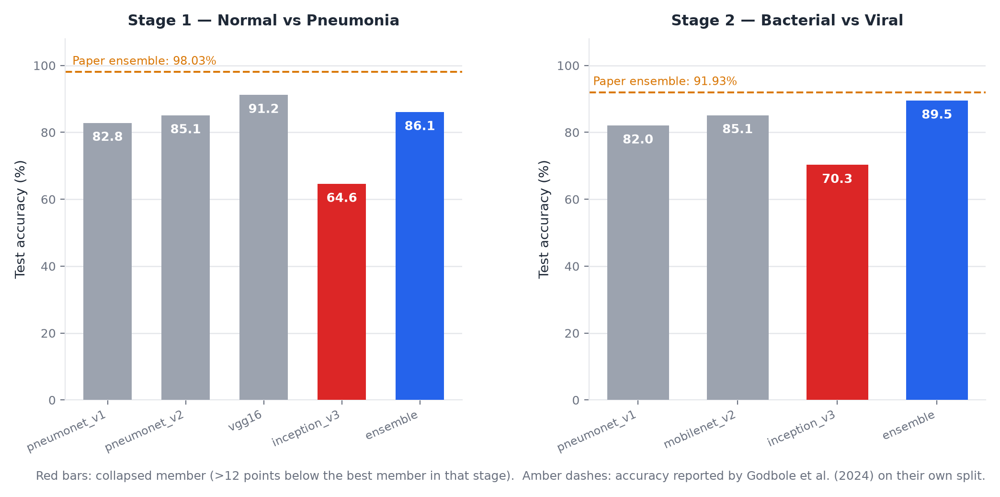
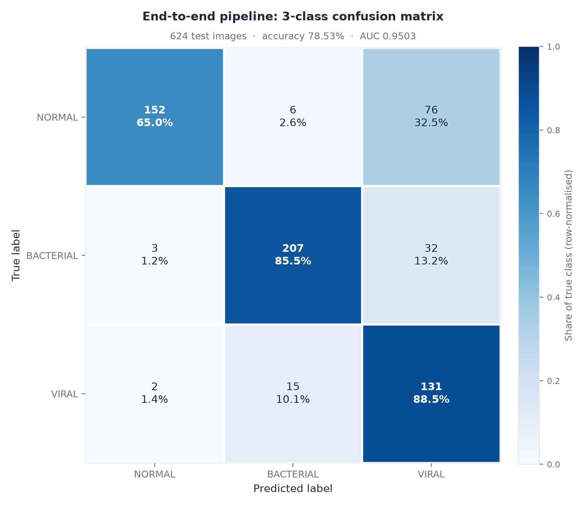
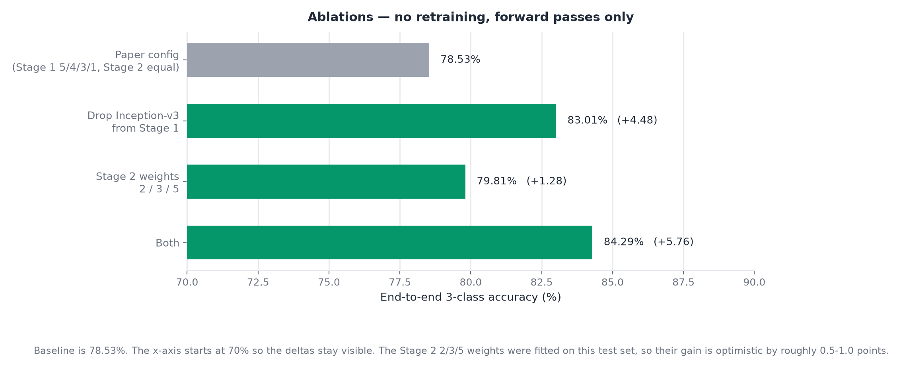

# Pneumonia Detection & Classification (Paediatric Chest X-Ray)

A reproducible, **educational** reimplementation of the two-stage ensemble
method from:

> **Enhancing Paediatric Pneumonia Detection and Classification Using Customized
> CNNs and Transfer Learning Based Ensemble Models**
> Shubham Godbole, Adit Kattukaran, Saurin Savla, Vedant Pradhan, Pratik Kanani,
> Deepali Patil. *Int. Res. J. Multidisc. Technovation*, 6(6) (2024) 38–53.
> DOI: [10.54392/irjtmt2463](https://doi.org/10.54392/irjtmt2463) · Paper licence: CC BY 4.0

**Not a medical device. For teaching, research and portfolio use only. See
[`NOTICE`](NOTICE).**

---

## The headline, honestly

The paper reports **98.03%** for its detection ensemble. This project does not
reproduce that number, and the reasons are documented rather than hidden.

| What | Accuracy | AUC |
|---|---:|---:|
| Stage 1 detection ensemble (Normal vs Pneumonia) | **86.06%** | 0.9634 |
| Stage 2 classification ensemble (Bacterial vs Viral) | **89.49%** | 0.9390 |
| Full pipeline, 3-class end to end | **78.53%** | 0.9503 |
| Same pipeline, Inception-v3 removed from Stage 1 | **83.01%** | — |
| Paper's detection ensemble | 98.03% | 0.97 |
| Paper's classification ensemble | 91.93% | 0.91 |

The paper's split, training budget and augmentation policy all differ from this
project's, and two of the paper's hyper-parameters were never published. The
gap is analysed by cause in [`docs/RESULTS.md`](docs/RESULTS.md) §9.

**The single most interesting finding** is not the accuracy at all: Inception-v3
collapsed during training (accuracy 0.6458, NORMAL recall **0.056**) yet still
carried 4 of the 13 ensemble votes. Removing that one member raises end-to-end
accuracy by **4.48 points**, with no retraining and no other change. It is a
measured demonstration that a broken ensemble member cannot be outvoted, only
removed.

---

## What you can do with it

* Reproduce every reported number from seven trained checkpoints in a few
  minutes.
* Reweight or drop ensemble members and re-score instantly — the ensembles are
  pure inference, so ablations cost forward passes, not GPU hours.
* Single-image inference on any of the seven models, any architecture.
* Regenerate all figures from a JSON results file.
* Run ten lab exercises ([`docs/EXERCISES.md`](docs/EXERCISES.md)), most of
  which need no GPU and no retraining.

```bash
# reproduce everything
python scripts/evaluate_stage1_ensemble.py --json results/stage1_ensemble.json
python scripts/evaluate_stage2_ensemble.py --json results/stage2_ensemble.json
python scripts/evaluate_full_pipeline.py  --ablate --json results/pipeline_ablation.json
python scripts/make_figures.py
pytest -q            # 44 tests
```

---

## What it is not

| Limitation | Detail |
|---|---|
| Clinical use | Trained on ages 1–5 from one institution; recognises exactly two subtypes; probabilities are uncalibrated. **Do not use on patients.** |
| The paper's result | 78.53% end to end. The 98.03% belongs to a different evaluation protocol and is not claimed here. |
| A service | No API, no UI, no ONNX/TorchScript export. It is a CLI plus evaluation scripts. |
| Bundled data | The dataset is not redistributed. Obtain it from its publisher. |
| Statistically strong | One 624-image test set; a 95% interval on the headline figure is roughly ±3.2 points. |

---

## How it works

```
chest X-ray (224×224, grayscale replicated to RGB)
        │
        ▼
┌──────────────────────────────────────────────┐
│ Stage 1 — Normal vs Pneumonia (detection)    │
│ VGG-16 (5) · Inception-v3 (4)                │
│ PneumoNet-v2 (3) · PneumoNet-v1 (1)          │  weighted average of
│                                              │  softmax probabilities
│ accuracy 0.8606 · recall 0.9872              │
└──────────────────────────────────────────────┘
        │
   ┌────┴────┐
   │ Normal  │──► stop
   └────┬────┘
        │ Pneumonia → Stage 2
┌──────────────────────────────────────────────┐
│ Stage 2 — Bacterial vs Viral                 │
│ Inception-v3 (Xception substitute)           │  equal weights
│ MobileNet-v2 · PneumoNet-v1                  │
│                                              │
│ accuracy 0.8949 · AUC 0.9390                 │
└──────────────────────────────────────────────┘
        │
        ▼
   NORMAL / BACTERIAL / VIRAL
```

Because Stage 1 runs first, its errors are unrecoverable: of the 134 pipeline
errors on the test set, **82 are healthy lungs flagged as pneumonia**, 5 are
pneumonias Stage 1 missed, and 47 are subtype confusions. That decomposition is
in [`docs/RESULTS.md`](docs/RESULTS.md) §6.

**Custom CNNs.** PneumoNet-v1 and PneumoNet-v2 are implemented from the paper's
architecture descriptions (Sections 3.3–3.4). **Transfer-learning backbones:**
VGG-16, VGG-19, Inception-v3, ResNet-50, ResNet-101, DenseNet-121,
DenseNet-169, MobileNet-v2. Xception is unavailable in torchvision and is
substituted by Inception-v3 — a deviation the whole project keeps visible.

---

## Results at a glance



| Model | Stage | Weight | Accuracy | AUC |
|---|---|---:|---:|---:|
| PneumoNet-v1 | 1 | 1 | 0.8285 | 0.9456 |
| PneumoNet-v2 | 1 | 3 | 0.8510 | 0.9298 |
| VGG-16 | 1 | 5 | **0.9119** | **0.9690** |
| Inception-v3 | 1 | 4 | 0.6458 | 0.7969 |
| PneumoNet-v1 | 2 | 1 | 0.8205 | 0.9396 |
| MobileNet-v2 | 2 | 1 | **0.8513** | 0.9370 |
| Inception-v3 (Xception substitute) | 2 | 1 | 0.7026 | 0.7845 |





Full tables, the gap analysis and threats to validity:
[`docs/RESULTS.md`](docs/RESULTS.md).

---

## Getting started

Full instructions, including the directory layout and a troubleshooting table:
[`docs/SETUP.md`](docs/SETUP.md).

```bash
python -m venv .venv
.venv\Scripts\Activate.ps1          # Windows PowerShell
# source .venv/bin/activate        # Linux / macOS

pip install -r requirements.txt
pip install -e .
pytest -q                            # expect 44 passed
```

Requires Python 3.9+. GPU optional for evaluation and everything downstream of
it.

Checkpoints are not in the repository. Put the seven `final_model.pt` files
where the scripts expect them, or point at them:

```bash
export PNEUMONIA_CHECKPOINT_DIR=/content/drive/MyDrive/PneumoniaProject/checkpoints
# Windows PowerShell
$env:PNEUMONIA_CHECKPOINT_DIR = "D:\checkpoints"
```

### Single-image inference

```bash
pneumonia infer --image path/to/xray.jpeg --checkpoint results/stage1_pneumonet_v1/final_model.pt

pneumonia infer --image path/to/xray.jpeg \
  --checkpoint results/stage1_vgg16/final_model.pt \
  --model vgg16 --labels Normal,Pneumonia
```

`--config`, `--model`, `--image-size` and `--labels` let any of the seven
checkpoints run. This scores a single model; for the full pipeline use
`scripts/evaluate_full_pipeline.py`.

### Training (optional)

The shipped checkpoints are already trained. To retrain from scratch:

```bash
python -m pneumonia train --config configs/stage1_vgg16.yaml \
  --data data/real_3class/train --checkpoint-dir results/stage1_vgg16
```

One config per model lives in `configs/`. `colab_full_training.ipynb` is the
end-to-end Google Drive workflow used to produce the shipped checkpoints;
`colab_stage1_training.ipynb` covers Stage 1 only.

---

## Repository layout

```
docs/
  RESULTS.md            every measured number, with the gap analysis
  SETUP.md              install, data layout, known-good values, troubleshooting
  EXERCISES.md          ten labs, most needing no GPU
  REPORT_TEMPLATE.md    IEEE-style write-up scaffold, pre-filled
  TODO.md               packaging checklist
  figures/              generated from results/reproduction_run.json
research/               paper notes, method spec, INFERRED/DEFAULT accounting
src/pneumonia/          data, models, transfer, ensemble, train, evaluate, cli,
                        reporting, checkpoints
configs/                one YAML per model
scripts/                train wrapper, three evaluation scripts, figure generation,
                        dataset preparation
tests/                  44 unit and integration tests
results/
  reproduction_run.json machine-readable source of truth for the published numbers
```

---

## How every number is labelled

The codebase tags every design decision so it stays auditable:

| Label | Meaning |
|---|---|
| `PAPER-STATED` | Stated in the source paper. |
| `INFERRED` | Not stated; an engineering decision was required. |
| `DEFAULT` | Not stated; an engineering default was chosen. |
| `UNKNOWN` | Not stated and no sensible choice was made. |

Every deviation, with its measured or expected impact, is listed in
[`research/assumptions-and-open-questions.md`](research/assumptions-and-open-questions.md)
and in the `deviations_from_paper` array of `results/reproduction_run.json`.

### Deviations that move the numbers

1. **Evaluation split.** The paper uses a stratified random 80:20 split over
   all 5,856 images; this project uses the official patient-disjoint Kermany
   split. The paper never publishes which images went where, so its split is
   not reproducible.
2. **Xception → Inception-v3.** torchvision has no Xception.
3. **Inception-v3 at 224×224** rather than its native 299×224. This is the
   measured cause of the Stage 1 collapse.
4. **Training schedule.** The paper does not state epochs, batch size or
   learning-rate decay. This project used 15 epochs at lr 1e-4 with no decay.
5. **Augmentation.** The paper pre-expands the training set offline (bacterial
   2,766→5,781, viral 1,514→3,149); this project transforms on the fly.
6. **Class weights and a fixed 0.5 threshold.** The paper describes neither.

---

## Documentation map

| Question | Go to |
|---|---|
| What did it actually achieve? | [`docs/RESULTS.md`](docs/RESULTS.md) |
| How do I run it? | [`docs/SETUP.md`](docs/SETUP.md) |
| What can I build on it? | [`docs/EXERCISES.md`](docs/EXERCISES.md) |
| How do I write it up? | [`docs/REPORT_TEMPLATE.md`](docs/REPORT_TEMPLATE.md) |
| What did the paper say, exactly? | [`research/paper-notes.md`](research/paper-notes.md) |
| Where were the assumptions? | [`research/assumptions-and-open-questions.md`](research/assumptions-and-open-questions.md) |
| What may I do with it? | [`LICENSE`](LICENSE) and [`NOTICE`](NOTICE) |

---

## Reproducibility

* Seeds fixed at 42 for splits and fixture generation.
* Versions at the time of the recorded run: `torch 2.14.1`,
  `torchvision 0.29.1`, `scikit-learn 1.9.1`, `Pillow 13.0.0`, `numpy 2.4.6`,
  `matplotlib 3.11.2`, Python 3.13 on Google Colab (CUDA).
* `pytest -q` — 44 tests covering the custom CNNs, transfer backbones, ensemble
  aggregation, data pipeline, training loop, checkpoint round-trip, the Stage 2
  breakdown helper and result serialisation.
* Every reported number is regenerated from `results/reproduction_run.json` by
  `scripts/make_figures.py`; nothing in the figures is hand-drawn.

---

## Licence and citation

Code: MIT ([`LICENSE`](LICENSE)). This is an independent reimplementation; it
is not affiliated with or endorsed by the paper's authors. The paper is CC BY
4.0 and must be attributed. The dataset and ImageNet-pretrained weights have
their own terms and are **not** redistributed here. Educational use only — see
[`NOTICE`](NOTICE).

If you use this work, cite both the software and the paper
([`CITATION.cff`](CITATION.cff)):

> S. Godbole, A. Kattukaran, S. Savla, V. Pradhan, P. Kanani, and D. Patil,
> "Enhancing Paediatric Pneumonia Detection and Classification Using Customized
> CNNs and Transfer Learning Based Ensemble Models," *Int. Res. J. Multidisc.
> Technovation*, vol. 6, no. 6, pp. 38–53, 2024, doi: 10.54392/irjtmt2463.
