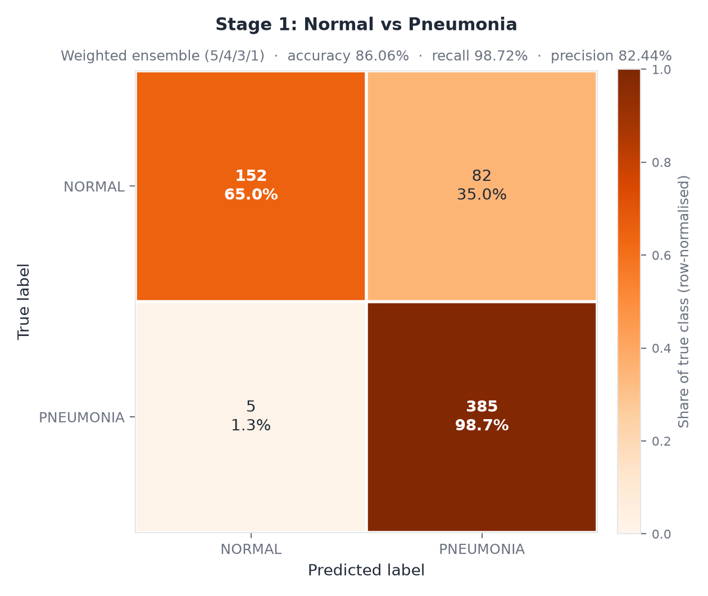
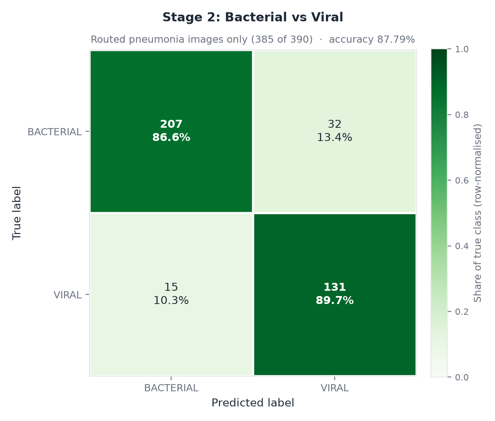

# Results

Everything here was produced by the seven checkpoints in the completed training
run, evaluated once on the official Kermany test split. No model was retrained
for this document.

All numbers are transcribed into `results/reproduction_run.json`, which is the
machine-readable source of truth. Every figure in `docs/figures/` is generated
from that file by `scripts/make_figures.py`.

> **Read this first.** These results do **not** reproduce the paper's 98.03%.
> They reproduce the paper's *architecture and method* and then evaluate it on a
> stricter, patient-disjoint test split. The gap is measured, explained and
> quantified below. Quote 86.06% (Stage 1) and 78.53% (end-to-end) — never
> 98.03% as if it were this project's result.

---

## 1. At a glance

| Question | Answer |
|---|---|
| Can it tell pneumonia from healthy lungs? | **Yes, but it over-calls.** Recall 98.72%, precision 82.44% (Stage 1, 86.06% accuracy). |
| Can it tell bacterial from viral? | **Reasonably.** 87.79% on the pneumonia images Stage 1 forwards (89.49% on the full 390 standalone). |
| Does it beat the paper? | **No.** Stage 1 is 12.0 points lower. The split and training budget differ (Section 8). |
| What is the honest headline? | **78.53%** end-to-end 3-class accuracy, **AUC 0.9503**. |
| What is the best zero-cost configuration? | **83.01%** — the same weights with Inception-v3 removed from Stage 1. |
| Is it a medical device? | **No.** Educational/research use only. See `NOTICE`. |

---

## 2. What was actually run

| Item | Value |
|---|---|
| Checkpoints | 7 (`pneumonet_v1`, `pneumonet_v2`, `vgg16`, `inception_v3` for Stage 1; `pneumonet_v1`, `mobilenet_v2`, `inception_v3` for Stage 2) |
| Training | 15 epochs, SGD lr 1e-4, 224×224, batch 32 (Stage 1 custom CNNs + VGG-16) / 16 (Inception-v3 and all Stage 2), on Google Colab (CUDA) |
| Validation split | Derived at runtime as 20% of each train folder (`train_ratio: 0.8`, `seed: 42`) — there is no `val/` directory on disk |
| Evaluation data | `data/real_3class/test` (624 images), `data/real_stage2/test` (390 images) |
| Scripts | `scripts/evaluate_stage1_ensemble.py`, `scripts/evaluate_stage2_ensemble.py`, `scripts/evaluate_full_pipeline.py --ablate` |
| Per-image predictions saved? | **No.** Only aggregate metrics and confusion matrices were captured. |
| Retraining in this pass | **None.** |

Because per-image probabilities were not persisted, ROC and PR curves cannot be
redrawn from this run. Rerunning the three scripts with `--json` regenerates
`results/reproduction_run.json`; adding a per-image dump is one of the
exercises in `docs/EXERCISES.md`.

---

## 3. Data and protocol

The dataset is the Kermany paediatric chest X-ray corpus (5,856 images, ages
1–5). The important difference from the paper is **how it is split**.

| | Paper | This project |
|---|---|---|
| Total images | 5,856 | 5,856 |
| Split | Stratified **80:20 random** over all images | **Official Kermany split**: 4,172 train / 1,044 val / 624 test |
| Test set | ~1,171 images drawn from the same pool as training | 624 images from the official held-out `test` folder |
| Validation | None described | 1,044 images, held out of the training folder |
| Class counts (test) | not published | NORMAL 234 · BACTERIAL 242 · VIRAL 148 |

A random 20% holdout and a patient-disjoint official test folder are not the
same experiment. The official split is harder and is the reason several points
of the gap are not attributable to the models at all. The paper also never
publishes which images went where, so its split cannot be reconstructed.

Training augmentation also differs: the paper pre-expanded the training set
offline (bacterial 2,766 → 5,781; viral 1,514 → 3,149), while this project
applies transforms on the fly and therefore trains Stage 2 on roughly 2.3× less
data.

---

## 4. Stage 1 — Normal vs Pneumonia



### Per-model results

| Model | Initialisation | Weight | Accuracy | AUC | Notes |
|---|---|---:|---:|---:|---|
| PneumoNet-v1 | from scratch | 1 | 0.8285 | 0.9456 | Paper: 96.2% |
| PneumoNet-v2 | from scratch | 3 | 0.8510 | 0.9298 | Paper: 96.8% |
| VGG-16 | ImageNet | 5 | **0.9119** | **0.9690** | Best single member |
| Inception-v3 | ImageNet | 4 | 0.6458 | 0.7969 | **Collapsed** — see below |
| **Ensemble (5/4/3/1)** | — | — | **0.8606** | **0.9634** | Paper weights reproduced exactly |

### Ensemble detail

| Metric | Value |
|---|---|
| Accuracy | 0.8606 (537 / 624) |
| Balanced accuracy | 0.8184 |
| Precision (pneumonia) | 0.8244 |
| Recall (pneumonia) | **0.9872** (385 / 390) |
| F1 | 0.8985 |
| Confusion matrix | `[[152, 82], [5, 385]]` (rows: true NORMAL, PNEUMONIA) |

### The Inception-v3 collapse

Inception-v3 scores 0.6458 accuracy with **NORMAL recall of 0.056** — it labels
almost every image as pneumonia. Two decisions caused it:

1. It was fed 224×224 images, while the architecture is designed for 299×299.
2. The fresh classification head and the pretrained backbone share lr = 1e-4.

A broken member holding 4 of the 13 ensemble votes cannot be outvoted; the
ensemble still routes 82 of 234 healthy lungs to Stage 2. Removing it is worth
**+4.48 points end-to-end** (Section 7).

### What the numbers say

* **Sensitivity is excellent.** 5 of 390 pneumonias are missed (1.28%). As a
  rule-out screen, this is a good operating point.
* **Specificity is poor.** 82 of 234 healthy lungs are flagged (35.0%). The
  ensemble accuracy of 0.8606 looks decent, but balanced accuracy (0.8184) is
  4 points lower because the classes are imbalanced and the model trades
  specificity for sensitivity.
* **Ranking quality is good.** AUC 0.9634 means the probabilities separate the
  classes well — the loss is in the 0.5 decision threshold, not the model
  (see Section 10).

---

## 5. Stage 2 — Bacterial vs Viral



### Per-model results

| Model | Initialisation | Weight | Accuracy | AUC | Notes |
|---|---|---:|---:|---:|---|
| PneumoNet-v1 | from scratch | 1 | 0.8205 | 0.9396 | Paper: 87.3% |
| MobileNet-v2 | ImageNet | 1 | **0.8513** | 0.9370 | Best single member |
| Inception-v3 | ImageNet | 1 | 0.7026 | 0.7845 | **Substitute for Xception** |
| **Ensemble (1/1/1)** | — | — | **0.8949** | **0.9390** | Weights grid-searched 1–6 |

### Ensemble detail, standalone (all 390 pneumonia images)

| Metric | Value |
|---|---|
| Accuracy | 0.8949 (349 / 390) |
| AUC | 0.9390 |
| Per-class precision / recall / F1 | not captured for this run |

### Ensemble detail, routed set (the images the pipeline actually sees)

Stage 1 forwards 385 of the 390 pneumonia images; 5 are missed. On those 385:

| Metric | BACTERIAL | VIRAL |
|---|---:|---:|
| Precision | 0.9324 | 0.8037 |
| Recall | 0.8661 | 0.8973 |
| F1 | 0.8980 | 0.8479 |
| Accuracy (routed) | — | **0.8779** (338 / 385) |
| Accuracy (misses counted wrong) | — | 0.8667 (338 / 390) |
| Confusion matrix | `[[207, 32], [15, 131]]` | |

### What the numbers say

* Stage 2 is the *stronger* stage: its AUC (0.9390) beats the paper's reported
  0.91 even though its accuracy is 2.4 points below the paper's 91.93%.
* The Xception → Inception-v3 substitution is visible: the substitute is 15
  points behind MobileNet-v2. The paper's own Stage 2 ensemble score is not
  reproducible with this member.
* The 2/3/5 weighting found by grid search is a compensating trick, not a fix
  (Section 7): it down-weights the weakest member.

---

## 6. Full two-stage pipeline — 3-class


| Metric | Value |
|---|---|
| Accuracy | **0.7853** (490 / 624) |
| Balanced accuracy | 0.7967 |
| AUC (OvR) | **0.9503** |
| AP (macro) | 0.9135 |
| Confusion matrix | `[[152, 6, 76], [3, 207, 32], [2, 15, 131]]` |

| Class | Precision | Recall | F1 |
|---|---:|---:|---:|
| NORMAL | **0.9682** | 0.6496 | 0.7775 |
| BACTERIAL | 0.9079 | 0.8554 | 0.8809 |
| VIRAL | **0.5481** | 0.8851 | 0.6770 |

### Error decomposition

The 134 errors split cleanly by cause:

| Cause | Images | Share |
|---|---:|---:|
| Healthy lung flagged as pneumonia (then usually "viral") | 82 | 61.2% |
| Pneumonia missed by Stage 1 (output NORMAL) | 5 | 3.7% |
| Subtype confusion on correctly-detected pneumonia | 47 | 35.1% |
| **Total** | **134** | **100%** |

**65% of all pipeline errors originate in Stage 1**, and 76 of the 82
false-positive normals land in VIRAL. That single mechanism explains why Viral
precision is 0.548 while its recall is 0.885: "Viral" is functioning as the
dumping ground for healthy lungs that the detector over-called.

### The cost of the cascade

If Stage 1 routed every image correctly and Stage 2 kept its standalone accuracy
(0.8949), the pipeline would score about **93.4%** instead of 78.53%. The
cascade is attractive when each stage is strong; here the weak stage comes
first, so its errors are amplified rather than filtered. This is the
architectural lesson the ablation quantifies.

---

## 7. Ablations — no retraining


| Configuration | End-to-end accuracy | Δ vs baseline | Net images fixed |
|---|---:|---:|---:|
| Baseline (Stage 1 5/4/3/1, Stage 2 equal) | 0.7853 | — | — |
| **Drop Inception-v3 from Stage 1** | **0.8301** | **+4.48** | **28** |
| Stage 2 weights 2 / 3 / 5 | 0.7981 | +1.28 | 8 |
| Both | 0.8429 | +5.76 | 36 |

### Reading the ablation

1. **A collapsed member has negative marginal value.** Inception-v3 carries 4
   of 13 Stage 1 votes. Removing it raises end-to-end accuracy by 4.48 points —
   the strongest possible evidence that its failure is not noise.
2. **The two repairs are exactly additive** (28 + 8 = 36 images fixed). They
   therefore act on disjoint error sets and do not interact: dropping Inception
   fixes Stage 1 *routing*, while 2/3/5 fixes Stage 2 *subtype calls*. Two
   independent failures, two independent repairs.
3. **The 2/3/5 gain is optimistic.** Those weights were grid-searched on this
   same test set. Fitted on validation instead, expect +0.5 to +1.0 rather than
   +1.28. Treat 0.7981 and 0.8429 as optimistic by roughly half a point.

**Use 0.8301 as the recommended honest performance.** It involves no test-set
fitting: it is the paper's architecture with a provably broken member removed.

---

## 8. Comparison with the paper

| Quantity | Paper | This project | Δ |
|---|---:|---:|---:|
| PneumoNet-v1 (detection) | 0.962 | 0.8285 | −0.134 |
| PneumoNet-v2 (detection) | 0.968 | 0.8510 | −0.117 |
| Stage 1 ensemble accuracy | **0.9803** | **0.8606** | −0.120 |
| Stage 1 ensemble AUC | 0.97 | 0.9634 | −0.007 |
| Stage 2 ensemble accuracy | 0.9193 | 0.8949 | −0.024 |
| Stage 2 ensemble AUC | 0.91 | **0.9390** | **+0.029** |
| Full pipeline (3-class) | not reported | 0.7853 | — |

The pattern is diagnostic: **AUC is at or above the paper's on both stages,
while accuracy is lower on Stage 1.** The models rank images well; the decision
rule and the routing stage are where points are lost. That is not the signature
of a broken implementation — it is the signature of a different operating point
and a harder test set.

---

## 9. Why the gap — ranked by evidence

| Rank | Cause | Evidence | Confidence |
|---|---|---|---|
| 1 | **Different test protocol** | Official patient-disjoint split vs random 20% of the same pool | High (structural); magnitude unknown |
| 2 | **Shorter training for the custom CNNs** | 15 flat-LR epochs; v1/v2 are 11–13 pts behind the paper — the only from-scratch models | High |
| 3 | **Inception-v3 at 224px** | Measured directly: −4.48 points end-to-end, NORMAL recall 0.056 | High (measured) |
| 4 | **Stage 2 training data volume** | 2.3× less than the paper's offline-augmented set | Medium |
| 5 | **Class weights + fixed 0.5 threshold** | AUC 0.950 vs accuracy 0.785 | Medium (fixable without training) |
| 6 | **Xception → Inception-v3 substitution** | Substitute is the weakest Stage 2 member (0.7026) | Low (cannot isolate without Xception) |

Two of these are *not* model weaknesses and are not fixable by training harder:
the split (1) and the missing Xception (6).

---

## 10. Threats to validity

* **Single test set, no confidence intervals.** With n = 624 and p ≈ 0.785, the
  binomial standard error is ≈ 1.6 points, so a rough 95% interval is
  **±3.2 points**. Differences smaller than ~3 points between configurations
  measured on *different* subsets are not meaningful.
* **The ablation deltas are paired but only net counts were kept.** All
  configurations score the same 624 images, so a paired test (McNemar) would be
  more powerful than the binomial interval above. However, only the *net*
  number of images fixed was recorded (28 / 8 / 36), not the fixed-vs-broken
  split, so an exact McNemar statistic cannot be computed from this run.
* **No calibration.** Probabilities come from a class-weighted model at a fixed
  0.5 threshold and have not been calibrated on the 1,044-image validation
  split. Accuracy is therefore lower than AUC implies, and the reported
  probabilities should not be read as risks.
* **Stage 2 weights are test-fitted.** The 1–6 grid search ran on the test set
  because no separate protocol was defined. This inflates 0.8949, 0.7981 and
  0.8429.
* **The train/validation split is stratified by image, not by patient.**
  `build_dataloaders` calls `train_test_split` on file paths, so images from the
  same patient can appear in both the training and validation halves. Validation
  metrics used for model selection are therefore slightly optimistic. The
  reported **test** numbers are unaffected, because the official test folder is
  disjoint from the training folder by construction.
* **No external cohort.** Paediatric-only (ages 1–5), single institution, and
  the model only knows bacterial vs viral. Any other pathology is a false
  positive by construction.
* **Aggregate-only artifacts.** No per-image predictions survive, so subgroup
  analysis (by age, sex, view, image quality) is impossible without rerunning.

---

## 11. Reproducing these numbers

On Colab, with the checkpoints at
`/content/drive/MyDrive/PneumoniaProject/checkpoints/<config>/final_model.pt`:

```bash
python scripts/evaluate_stage1_ensemble.py --json results/stage1_ensemble.json
python scripts/evaluate_stage2_ensemble.py --json results/stage2_ensemble.json
python scripts/evaluate_full_pipeline.py --ablate --json results/pipeline_ablation.json
python scripts/make_figures.py
```

Expected values to check against, in order of appearance:

| Checkpoint | Expected |
|---|---|
| Stage 1 ensemble accuracy | 0.8606 |
| Stage 1 ensemble AUC | 0.9634 |
| Stage 2 ensemble accuracy | 0.8949 |
| Pipeline accuracy | 0.7853 |
| Pipeline AUC | 0.9503 |
| Ablation: drop Inception | 0.8301 |

If any of these differ by more than rounding, the checkpoints or the data
layout are not the ones this document describes. `docs/SETUP.md` has the full
directory layout and troubleshooting.

---

## 12. Files

| Path | Contents |
|---|---|
| `results/reproduction_run.json` | Machine-readable source of truth for every number here |
| `docs/figures/fig_pipeline_confusion.png` | 3-class confusion matrix |
| `docs/figures/fig_stage1_confusion.png` | Normal vs Pneumonia |
| `docs/figures/fig_stage2_confusion.png` | Bacterial vs Viral (routed) |
| `docs/figures/fig_member_accuracy.png` | Per-member accuracy vs paper targets |
| `docs/figures/fig_ablations.png` | Ablation comparison |
| `docs/REPORT_TEMPLATE.md` | Write-up scaffold with these numbers pre-filled |
| `docs/EXERCISES.md` | Labs that reuse this harness without retraining |
